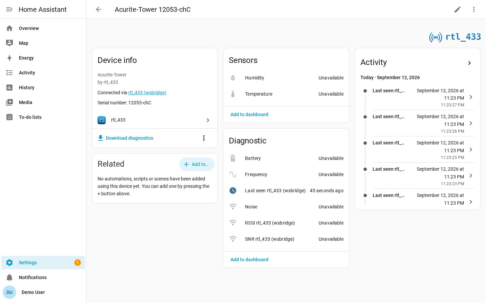

# Availability

RF devices announce their availability only by transmitting, so the integration
uses a silence-based availability model. If no event for a device arrives within
its availability timeout, its entities become `unavailable`.



## Transmission Patterns

How long a device can reasonably stay silent depends on the device type.

| Device type | Typical behavior |
| --- | --- |
| Periodic weather, temperature, soil, and air-quality sensors | Transmit at regular intervals. |
| Door/window contacts, motion/PIR, buttons, doorbells, and security sensors | Transmit on events, sometimes with an occasional heartbeat. |
| Generic EV1527 door/PIR devices and parked TPMS sensors | May have no heartbeat and stay silent for days. |

Periodic devices use finite timeouts. Event-driven devices default to never
expiring because a long silence is normal and does not imply failure.

## Hub Connection

When the connection to the rtl_433 server drops, every device on that hub
immediately becomes `unavailable`. This includes event-driven devices and
**Last seen** sensors, regardless of their timeout settings. While disconnected,
the integration cannot tell whether a device is still transmitting.

When the connection returns, devices show their last received values and the
usual silence timeouts resume.

If you want an automation to tolerate short blips, condition it on the hub's
**Connectivity** binary sensor with a `for:` delay rather than reacting to each
device going unavailable.

The **rtl_433 server unreachable** repair notification waits 90 seconds, so a
routine server restart does not produce a notification.

For `event` entities (buttons, doorbells, remotes), use the `event.received`
trigger. It ignores transitions out of `unavailable`, so reconnecting does not
trigger an automation for an old press.

The hub's SDR controls (**Gain**, **Sample rate**, **Frequency correction**,
**Hop interval**, **Conversion mode**) stay available so you can change settings
while disconnected. With **Manage SDR settings** on, these appear as
`number`/`select` entities. Turning it off replaces them with read-only diagnostic
sensors, which become unavailable on disconnect along with the hub's other
diagnostic sensors.

The **Connectivity** binary sensor is the entity that reports the outage: it
reads the socket state directly and stays available throughout. The Home
Assistant log records the drop and the reconnect:

```text
INFO  rtl_433 lost the connection to ws://rtl433.local:8433/ws; reconnecting, and marking all 12 device(s) ...
INFO  rtl_433 reconnected to ws://rtl433.local:8433/ws after 184s
```

## Timeout Sources

The effective availability timeout is resolved in this order:

1. Per-device override from **Device settings**.
2. Hub default from **Receiver settings**, if set.
3. Device-class default.
4. 600 second fallback.

Set a timeout to `0` to make a device never expire. This is already the automatic
default for event-driven devices.

**Receiver settings** offers *Per-device-type defaults*, *Never expire*, or
*a fixed timeout*. Choosing a fixed timeout of 600 seconds applies that hub
default at step 2, including to event-driven devices. The 600-second fallback at
step 4 applies only when no earlier rule supplies a timeout.

## Restart Behavior

On Home Assistant restart, the last known states are restored first. The timeout
then runs from the restart time, and entities become unavailable if no
new event arrives within the timeout.

## Last Seen Sensor

Every device gets a diagnostic timestamp sensor named **Last seen**. It reports
when the device was last heard from and restores its previous value across
restarts.

Last seen is enabled by default for event-driven devices because they never
expire and the timestamp is their freshness signal. It is disabled by default for
periodic devices, whose availability already conveys freshness.

Unlike measurement sensors, Last seen stays available after the device falls
silent, so it can drive staleness automations. It does go unavailable while the
hub connection is down, because the timestamp then only records when the
integration stopped listening.
