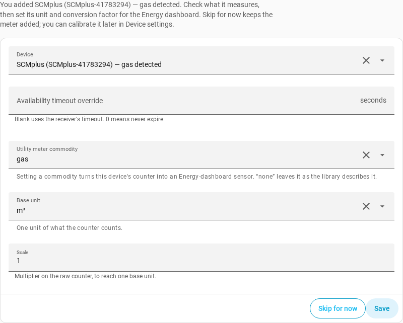

# Utility-Meter Calibration

Some electricity, gas, and water meters send a running total without saying
which unit it uses. Calibration tells the integration how to convert that
number into a reading Home Assistant's Energy dashboard can use.

Until you calibrate one of these meters, its consumption sensor shows a counter
without a unit. This applies to meters using the SCM, ERT, and SCMplus protocols.

## Calibrating a Meter

After you click **Add** on a recognized meter in **Discovered devices**, its
**Device settings** page opens. Check whether it measures electricity, gas, or
water, then choose the unit and conversion factor described below. Click
**Save** to apply them, or **Skip for now** to leave the meter added without
calibration.

Closing the page without saving also keeps the meter added. You can calibrate
it later.

To calibrate a meter you added earlier, or to change a calibration, open
**Settings → Devices & Services → rtl_433 → Configure → Device settings** and
pick the meter.

The integration fills in the meter type when it can detect it. You can change
this choice. Opening a calibrated meter shows its saved settings.

| Field | Meaning |
| --- | --- |
| **Utility meter commodity** | What the meter measures: `energy` (electricity), `gas`, or `water`. Saving `none` removes any calibration. |
| **Base unit** | The unit you want the reading expressed in, such as kWh or m³. The choices depend on what the meter measures. |
| **Scale** | The number to multiply the meter's counter by to get a reading in your chosen unit. For example, if 100 counts mean 1 m³, enter `0.01`. Check your meter's documentation or compare its counter with the physical meter before choosing a scale. |

The base unit and scale appear after you choose electricity, gas, or water.

Once calibrated, the consumption sensor has the type and unit the Energy
dashboard needs. You can choose a different display unit later in the entity's
Home Assistant settings.

The counter field itself needs no configuration: SCM and ERT meters report
`consumption_data` and SCMplus meters report `Consumption`, and both ship in the
device library. Neither requires a YAML override.

## Changing a Calibration

Choose the unit and scale carefully before calibrating. Changing them later can
interrupt the meter's long-term statistics in Home Assistant. The entity keeps
its ID, but earlier statistics may no longer be linked to the new readings.

Saving a calibration briefly reloads the receiver so the sensor can use the
new settings.

## Model-Scoped Mappings

For models whose unit and scale are confirmed, a contributor can add
a model-scoped mapping to the [device library](device-library.md#model-scoped-mappings-models)
so those meters work without per-device calibration.

The device library does not guess meter scales: a wrong scale would produce
incorrect Energy dashboard readings.
