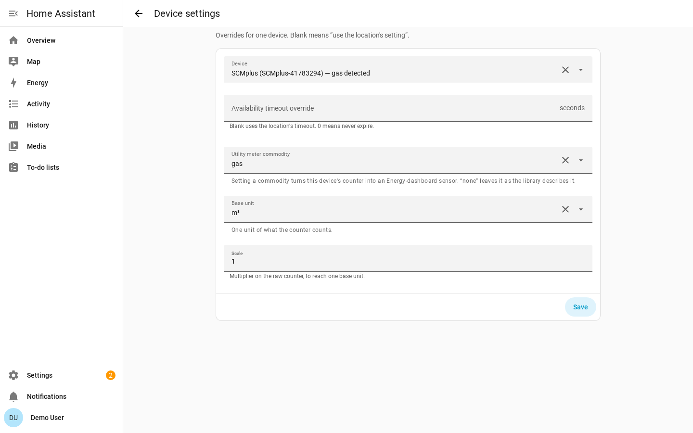

# Utility-Meter Calibration

Utility meters decoded by SCM, ERT, and SCMplus protocols report a raw
consumption counter, but the RF signal does not carry the counter's unit or
scale. Meters use different counter scales, so the integration needs calibration
before their readings can be used in the Energy dashboard.

Out of the box, consumption is a plain unitless `total_increasing` counter. To
make it eligible for Home Assistant's Energy dashboard, calibrate the device.

## Calibrating a Meter

Open **Settings → Devices & Services → rtl_433 → Configure (the gear icon) →
Device settings** and pick the meter.

The device picker labels meters with their detected commodity (energy, gas, or
water). When the meter reports a `MeterType` or `ert_type` hint,
the commodity is pre-filled from it. You can override it, and re-editing an
already-calibrated device shows its stored commodity, unit and scale.

| Field | Meaning |
| --- | --- |
| **Commodity** | `none`, `energy`, `gas`, or `water`. This sets the sensor's device class. Choosing `none` clears the calibration and leaves the counter unitless. |
| **Base unit** | The unit the calibrated counter is expressed in, constrained to the Home Assistant units that are convertible for that commodity. |
| **Scale** | Multiplier applied to the raw counter so the stored value is in the chosen base unit. |

The base unit and scale only appear once you have chosen a real commodity, and
available units depend on the commodity and are compatible with the Energy
dashboard.

Once calibrated, the consumption sensor gets a device class, native unit,
and `state_class: total_increasing`. You do not need to pick the display unit in
the calibration flow: Home Assistant can convert convertible units in the entity
settings.

The counter field itself needs no configuration: SCM and ERT meters report
`consumption_data` and SCMplus meters report `Consumption`, and both ship in the
device library. Neither requires a YAML override.

## Statistics Caveat

Changing commodity, base unit, or scale changes the sensor's native unit or
device class. Home Assistant treats that as a non-convertible change for long
term statistics.

The entity keeps its ID, but previous long-term statistics are orphaned. Choose
the unit and scale carefully before calibrating. Saving a calibration reloads
the location so the sensor is rebuilt with the new unit and class.

## Model-Scoped Mappings

For models whose unit and scale are confirmed, a contributor can ship
a model-scoped mapping in the [device library](device-library.md#model-scoped-mappings-models)
so those meters work without per-device calibration.

pyrtl_433 does not include speculative real-meter consumption mappings. A
wrong scale would silently corrupt Energy data.
